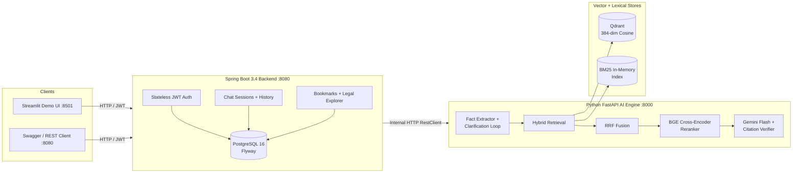
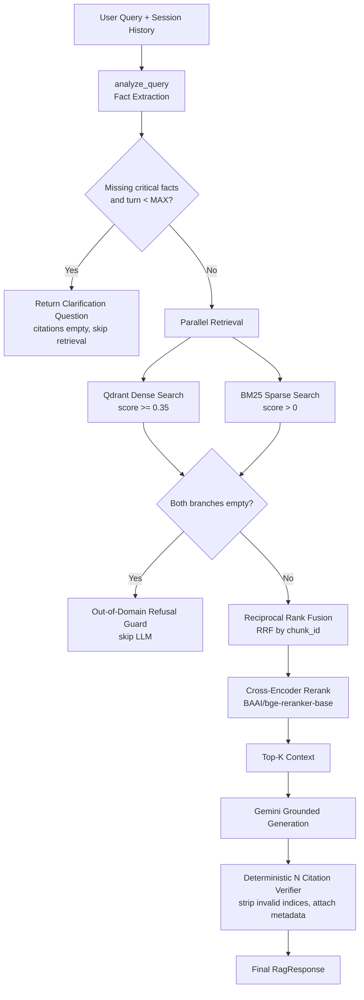
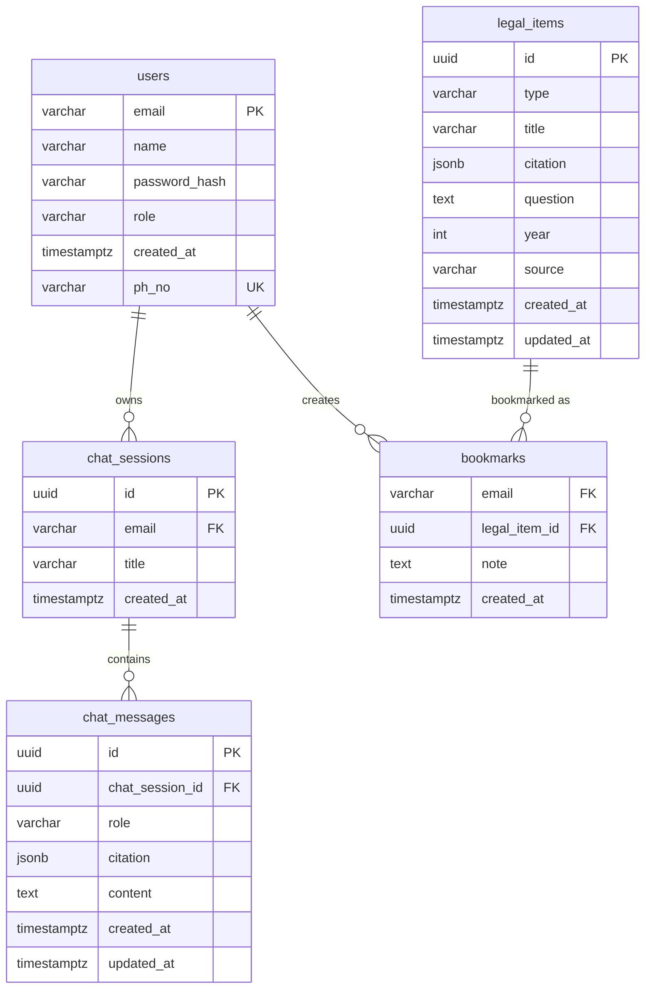
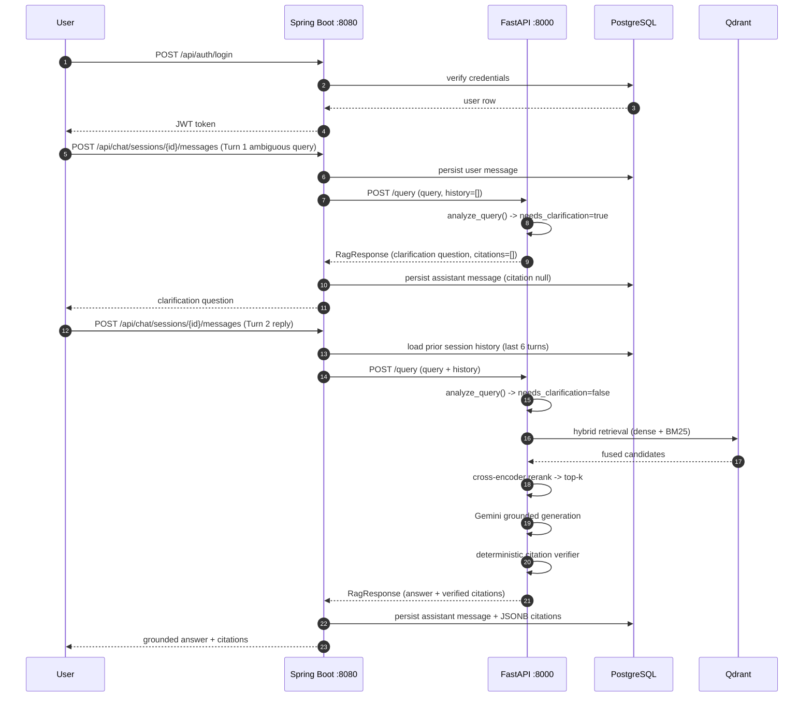

# JuRA — Juristic Retrieval-Augmented Intelligence

> An evidence-backed Indian legal awareness & case-preparation engine powered by Hybrid Retrieval (BM25 + Qdrant), Cross-Encoder Reranking, and Deterministic Citation Verification.

[](https://openjdk.org/)
[](https://spring.io/projects/spring-boot)
[](https://www.python.org/)
[](https://fastapi.tiangolo.com/)
[](https://qdrant.tech/)
[](https://www.postgresql.org/)
[](https://ai.google.dev/)
[](https://streamlit.io/)

### Engineering Highlights

- **4,704 Structure-Aware Chunks** indexed across 6 Indian legal texts (Constitution of India 2026, BNS, BNSS, BSA, IPC, CrPC) with `CURRENT` / `SUPERSEDED` / `REPEALED` lifecycle filtering.
- **+65.7% MRR Lift (`0.533 → 0.883`)** and **5× Exact Lookup Gain (`0.167 → 0.833 R@1`)** empirically benchmarked across a 30-query legal evaluation suite.
- **Zero-Hallucination Citation Verifier:** programmatically maps `[N]` markers strictly to retrieved Qdrant chunk metadata and strips ungrounded references before returning responses.
- **Multi-Turn Clarification Loop:** detects missing legal triggers in real-life disputes and asks targeted follow-up questions before retrieving statutes.

---

## Problem & Solution

Naive LLMs fail on Indian law in predictable ways: they invent section numbers, break clause boundaries, and silently conflate repealed IPC/CrPC provisions with active BNS/BNSS/BSA replacements. JuRA replaces free-form generation with a grounded pipeline — structure-aware chunking preserves article/section boundaries, hybrid retrieval (BM25 + dense Qdrant + RRF) finds exact provisions, a cross-encoder reranker lifts the right one to rank 1, and a deterministic verifier attaches citations only from retrieved chunk metadata. The result: every answer is traceable to a real page of a real statute, or the system refuses to answer.

---

## System Architecture



---

## RAG Pipeline Activity Diagram



---

## Deep-Dive Architecture Diagrams

<details>
<summary><b>Database Schema (ER Diagram — PostgreSQL 16)</b></summary>



</details>

<details>
<summary><b>End-to-End Multi-Turn User Flow (Sequence Diagram)</b></summary>



</details>

---

## Empirical Retrieval Benchmarks & Key Engineering Decisions

### 3-Stage Benchmark (30-query gold set, k=5)

| Stage | Semantic R@1 | Semantic R@5 | Exact R@1 | Exact R@5 | Overall R@1 | Overall R@5 | Overall MRR |
|---|---|---|---|---|---|---|---|
| Dense-Only (all-MiniLM-L6-v2) | 0.778 | 0.778 | 0.167 | 0.167 | 0.533 | 0.533 | 0.533 |
| Hybrid (Dense + BM25 + RRF) | 0.667 | 0.889 | 0.333 | 1.000 | 0.533 | 0.933 | 0.660 |
| **Hybrid + Cross-Encoder (bge-reranker-base)** | **0.833** | **0.889** | **0.833** | **1.000** | **0.833** | **0.933** | **0.883** |

### Key Engineering Decisions

- **Why Hybrid + Reranking:** Dense embeddings (all-MiniLM-L6-v2) match concepts but lose exact numerals — "Article 14" retrieved Articles 228, 21, 137. BM25 finds the numeral; RRF keeps both signals without either dominating; the cross-encoder reads (query, passage) jointly and lifts Recall@1 from 0.533 to 0.833.
- **Why Deterministic Citation Verification:** The LLM is instructed to cite only with bracket numbers `[1]..[N]`. `rag_service.verify_citations()` maps each `[N]` to `chunks[N-1]` and builds `Citation` objects exclusively from retrieved chunk metadata; out-of-range markers are stripped and logged. An invented citation can never reach the user.
- **Why Dual-Service (Spring Boot + Python):** Java owns auth, sessions, bookmarks, and PostgreSQL persistence with Flyway + JWT; Python owns the ML stack (embeddings, Qdrant, BM25, cross-encoder, Gemini). The two communicate via a narrow JSON contract (`RagQueryRequest` / `RagResponseDto`), so either side can evolve independently.

---

## Tech Stack & Quick Start

### Tech Stack

| Layer | Technologies |
|---|---|
| AI & Retrieval | sentence-transformers (all-MiniLM-L6-v2), rank-bm25, Qdrant, CrossEncoder (BAAI/bge-reranker-base), Google Gemini 2.5 Flash |
| Backend & Security | Java 21, Spring Boot 3.4.3, Spring Security 6, Stateless JWT (jjwt 0.12.6), Spring Data JPA, Flyway, springdoc OpenAPI |
| Databases & Infra | PostgreSQL 16, Qdrant (Docker), Docker Compose |
| UI & Testing | Streamlit, JUnit 5 + Mockito, pytest (100 Python tests), Maven |

### Quick Start (4 steps)

```bash
# 1. Start infrastructure (Qdrant + PostgreSQL 16)
docker compose up -d

# 2. Python AI engine: venv, deps, ingest corpus, run
cd python-ai-engine
python -m venv .venv && .venv\Scripts\Activate.ps1   # or: source .venv/bin/activate
pip install -r requirements.txt
cp .env.example .env   # set GOOGLE_API_KEY for grounded answers
python scripts/ingest_documents.py
uvicorn app.main:app --host 0.0.0.0 --port 8000 --reload

# 3. Spring Boot backend
cd ../backend
mvn spring-boot:run   # http://localhost:8080  (Swagger: /swagger-ui.html)

# 4. Streamlit demo UI
cd ../python-ai-engine
streamlit run ui.py   # http://localhost:8501
```

Offline tests: `mvn clean test` (23 passed, 1 skipped) and `pytest tests -q` (100 passed). The live end-to-end test is gated behind `JURA_LIVE_AI=true`.

<details>
<summary><b>REST API Endpoints Reference</b></summary>

| Method | Endpoint | Description |
|---|---|---|
| POST | `/api/auth/register` | Register a new user (BCrypt) |
| POST | `/api/auth/login` | Authenticate, receive JWT |
| GET | `/api/users/me` | Current user profile |
| POST | `/api/chat/sessions` | Create chat session |
| GET | `/api/chat/sessions` | List user sessions |
| GET | `/api/chat/sessions/{id}/messages` | Session message history |
| POST | `/api/chat/sessions/{id}/messages` | Send query, invoke RAG, persist answer + citations |
| GET | `/api/bookmarks` | List bookmarks |
| POST | `/api/bookmarks` | Create bookmark |
| PATCH | `/api/bookmarks/{legalItemId}` | Update bookmark note |
| DELETE | `/api/bookmarks/{legalItemId}` | Remove bookmark |
| GET | `/api/legal-items` | Paginated legal items (filters: type, year, source, query) |
| GET | `/api/legal-items/{id}` | Legal item by UUID |
| GET | `/api/health` | Service + subsystem health |

Python engine: `GET /health`, `POST /query` (body: `{query, limit, document_type, legal_status, history}`).

</details>

<details>
<summary><b>Environment Variables Reference</b></summary>

**Backend** (`backend/src/main/resources/application.yml`):

| Variable | Description | Default |
|---|---|---|
| `DATABASE_URL` | PostgreSQL JDBC URL | `jdbc:postgresql://localhost:5432/jura_db` |
| `DATABASE_USERNAME` | DB user | `postgres` |
| `DATABASE_PASSWORD` | DB password | `postgres` |
| `JWT_SECRET` | Base64 256-bit signing key | *(dev default committed)* |
| `JWT_EXPIRATION` | Token validity (ms) | `86400000` |
| `PYTHON_AI_BASE_URL` | FastAPI base URL | `http://localhost:8000` |

**Python AI engine** (`python-ai-engine/.env`, see `.env.example`):

| Variable | Description | Default |
|---|---|---|
| `QDRANT_HOST` / `QDRANT_PORT` | Qdrant connection | `localhost` / `6333` |
| `QDRANT_COLLECTION_NAME` | Collection name | `jura_legal_chunks` |
| `EMBEDDING_MODEL_NAME` | Must match ingestion model | `sentence-transformers/all-MiniLM-L6-v2` |
| `EMBEDDING_DIMENSION` | Vector dimension | `384` |
| `MAX_CHUNK_CHARS` | Fallback max chars per chunk | `1500` |
| `MIN_SIMILARITY_SCORE` | Cosine floor for relevance | `0.35` |
| `HYBRID_SEARCH_ENABLED` | BM25 + dense + RRF | `true` |
| `RRF_K` | RRF constant | `60` |
| `HYBRID_CANDIDATE_MULTIPLIER` | Candidates per branch | `4` |
| `RERANKER_ENABLED` | Cross-encoder second stage | `true` |
| `RERANKER_MODEL_NAME` | Cross-encoder model | `BAAI/bge-reranker-base` |
| `RERANKER_CANDIDATE_K` | Candidates to rerank | `15` |
| `CLARIFICATION_ENABLED` | Missing-fact clarification loop | `true` |
| `MAX_CLARIFICATION_TURNS` | Max clarification turns | `1` |
| `GOOGLE_API_KEY` | Google AI Studio key (required for `/query`) | *(empty)* |
| `GEMINI_MODEL_NAME` | Generation model | `gemini-2.5-flash` |

</details>

---

## Project Structure

```
JuRA/
├── backend/                          # Spring Boot 3.4 (Java 21)
│   ├── pom.xml
│   └── src/main/java/com/jura/jura_backend/
│       ├── client/                   # PythonRagClient (RestClient)
│       ├── config/                   # Security, OpenAPI
│       ├── controller/               # Auth, Chat, Bookmarks, LegalItems, User, Health
│       ├── dto/                      # Request/Response DTOs (rag, chat, auth, ...)
│       ├── entity/                   # JPA entities (User, ChatSession, ChatMessage, ...)
│       ├── exception/                # GlobalExceptionHandler
│       ├── repository/               # Spring Data JPA repos
│       ├── security/                 # JWT filter + service
│       └── service/                  # AuthService, ChatService, BookmarkService, ...
│   └── src/main/resources/db/migration/   # V1 schema, V2 seed data
├── python-ai-engine/
│   ├── app/
│   │   ├── config/settings.py
│   │   ├── embeddings/               # all-MiniLM-L6-v2 (384-dim, truncation-safe)
│   │   ├── ingestion/                # PDF loader, cleaner, structure-aware chunker
│   │   ├── models/                   # Chunk, Document, RagResponse, ChatTurn, ExtractedFacts
│   │   ├── rag/                      # prompt_builder, rag_service, fact_extractor
│   │   ├── retrieval/                # retriever (hybrid+RRF+rerank), bm25_index, reranker
│   │   └── vectorstore/              # Qdrant client
│   ├── scripts/                      # ingest_documents, search_documents, evaluate_retrieval
│   ├── eval/gold_queries.json        # 30-query gold set
│   ├── tests/                        # 100 pytest tests
│   ├── legal-data/                   # 6 legal PDFs (Constitution, BNS, BNSS, BSA, CrPC, IPC)
│   ├── ui.py                         # Streamlit demo
│   ├── requirements.txt
│   └── .env.example
├── docker-compose.yml                # Qdrant + PostgreSQL 16
└── README.md
```

### Test Suite

```bash
# Python (100 tests)
cd python-ai-engine && pytest tests -q

# Java (23 tests, 1 skipped offline)
cd backend && mvn clean test
```

---

## Disclaimer

JuRA is an **educational legal-awareness and case-preparation tool**. It is **not** a substitute for professional legal advice. Always consult a qualified legal practitioner for matters affecting your rights. All citations reference publicly available Indian statutes; verify every citation against the original source before relying on it in any proceeding.

---

*Built with grounded retrieval, verified citations, and empirical benchmarking — every claim in this README is backed by code and tests.*
